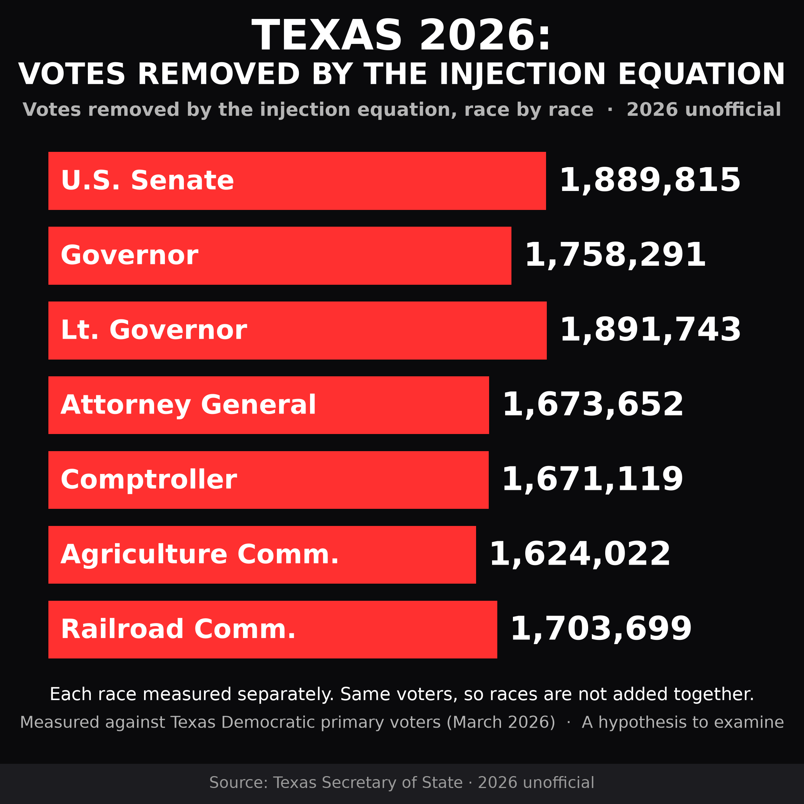
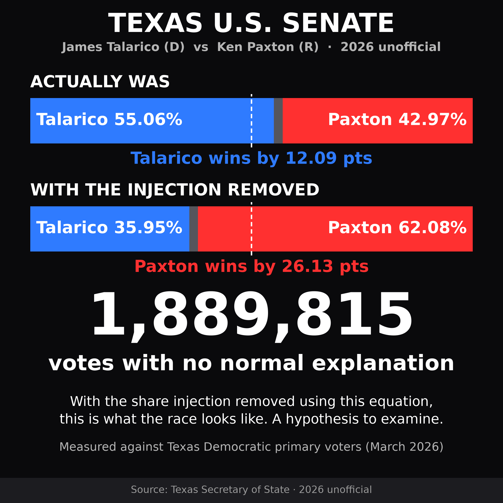
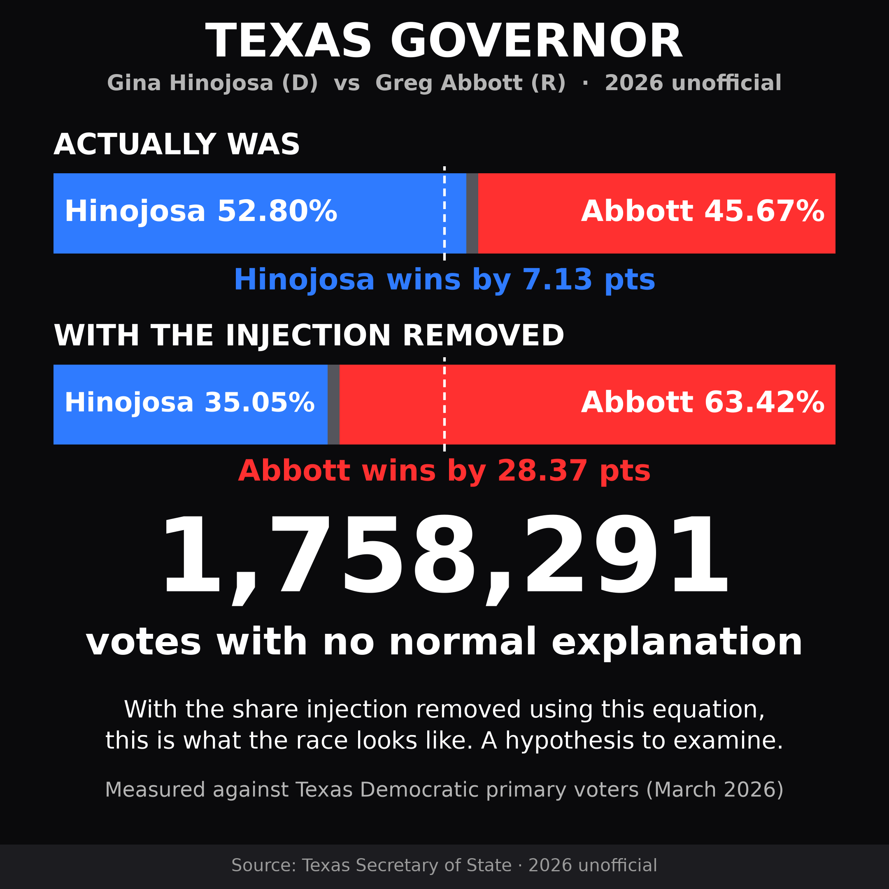
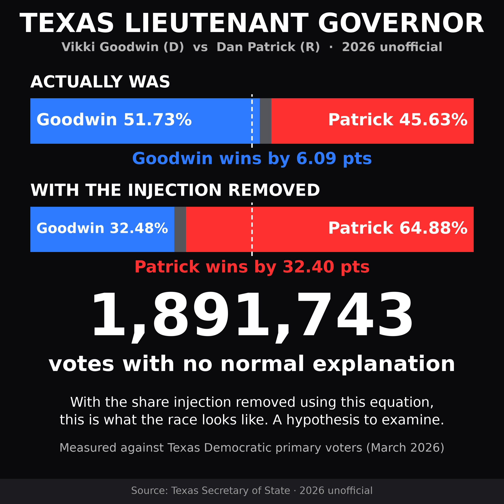
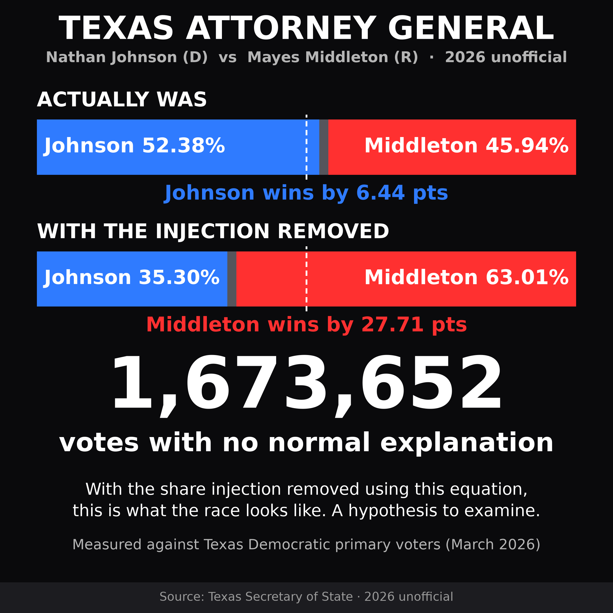
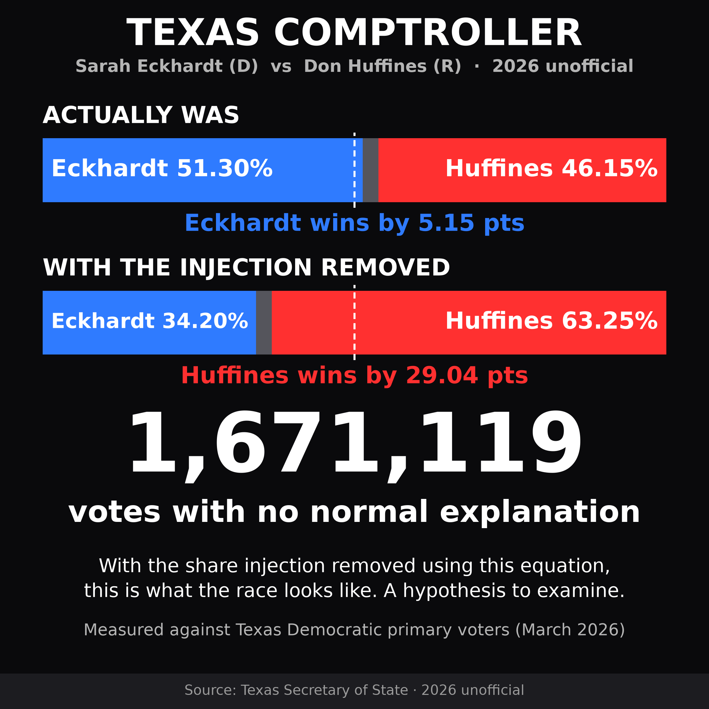
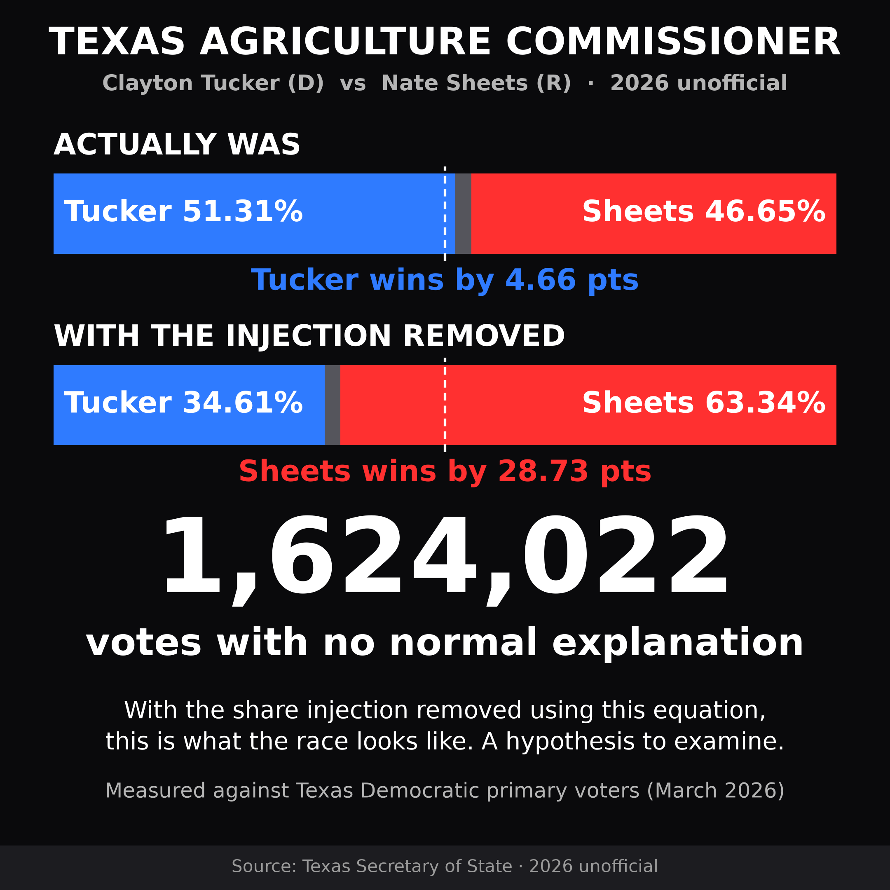
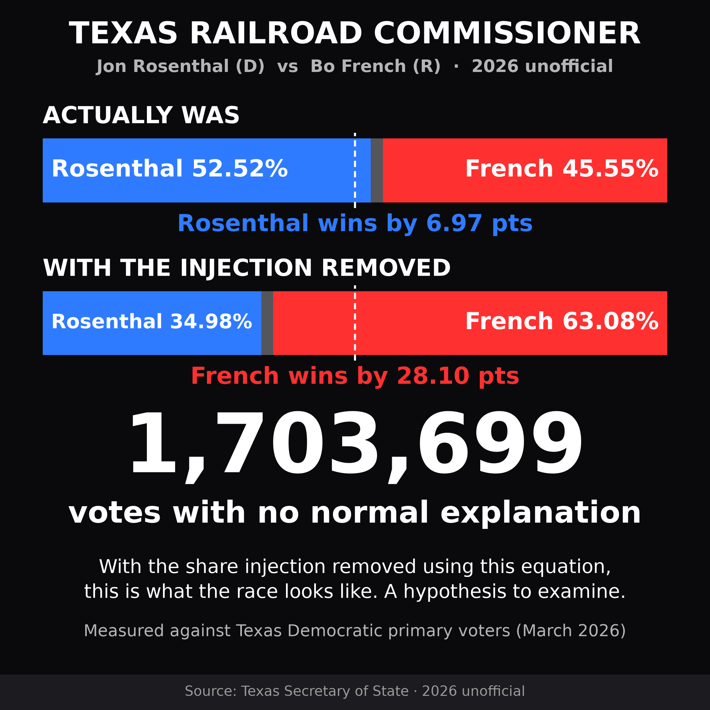

# Texas 2026: Full Reversal Analysis

> **\*2026 results are unofficial** (Texas Secretary of State election-night file, election 53815, before the state canvass). **Texas has no party registration:** "Democratic primary voters" means the Democratic share of March 2026 Governor-primary voters, used as the stand-in for registration. This is a hypothesis to examine. The arithmetic measures a pattern; it cannot prove cause.

This analysis reverses all seven 2026 statewide races, county by county, across all 254 Texas counties. Every figure was checked by two independent passes against the raw Texas Secretary of State files: 62,545 checks, 0 mismatches.

## Start here

1. [Full Reversal Analysis](docs/Full-Reversal-Analysis.md): the equation, statewide before and after, who wins, the top ten counties, data-quality flags, and verification
2. [Methodology: How This Analysis Was Done](docs/Methodology-How-This-Analysis-Was-Done.md): step by step, with a worked Harris County example
3. [Summary report](TX_full_reversal_summary_report.md)

## All 254 counties, by race

| Race | Votes removed by the injection equation | County page | Data |
|---|---|---|---|
| U.S. Senate | 1,889,815 | [254 counties](docs/Full-Reversal-Senate-Counties.md) | [CSV](master/TX_senate_full_reversal_master_254_counties.csv) · [XLSX](master/TX_senate_full_reversal_master.xlsx) · [Top 10](master/TX_senate_top10_removals.csv) |
| Governor | 1,758,291 | [254 counties](docs/Full-Reversal-Governor-Counties.md) | [CSV](master/TX_governor_full_reversal_master_254_counties.csv) · [XLSX](master/TX_governor_full_reversal_master.xlsx) · [Top 10](master/TX_governor_top10_removals.csv) |
| Lieutenant Governor | 1,891,743 | [254 counties](docs/Full-Reversal-Lt-Governor-Counties.md) | [CSV](master/TX_lt_governor_full_reversal_master_254_counties.csv) · [XLSX](master/TX_lt_governor_full_reversal_master.xlsx) · [Top 10](master/TX_lt_governor_top10_removals.csv) |
| Attorney General | 1,673,652 | [254 counties](docs/Full-Reversal-Attorney-General-Counties.md) | [CSV](master/TX_attorney_general_full_reversal_master_254_counties.csv) · [XLSX](master/TX_attorney_general_full_reversal_master.xlsx) · [Top 10](master/TX_attorney_general_top10_removals.csv) |
| Comptroller | 1,671,119 | [254 counties](docs/Full-Reversal-Comptroller-Counties.md) | [CSV](master/TX_comptroller_full_reversal_master_254_counties.csv) · [XLSX](master/TX_comptroller_full_reversal_master.xlsx) · [Top 10](master/TX_comptroller_top10_removals.csv) |
| Agriculture Commissioner | 1,624,022 | [254 counties](docs/Full-Reversal-Agriculture-Commissioner-Counties.md) | [CSV](master/TX_agriculture_full_reversal_master_254_counties.csv) · [XLSX](master/TX_agriculture_full_reversal_master.xlsx) · [Top 10](master/TX_agriculture_top10_removals.csv) |
| Railroad Commissioner | 1,703,699 | [254 counties](docs/Full-Reversal-Railroad-Commissioner-Counties.md) | [CSV](master/TX_railroad_full_reversal_master_254_counties.csv) · [XLSX](master/TX_railroad_full_reversal_master.xlsx) · [Top 10](master/TX_railroad_top10_removals.csv) |

Each race is measured separately. They are the same voters, so the races are not added together.

## Graphics

## Read before presenting

- **Most of each flip comes from the statewide offset, not the county-by-county gaps.** The offset is 67.0–75.6% of the votes removed in each race, because it is taken off every county, including counties sitting exactly on the line. See [Where the offset fits in](docs/Full-Reversal-Analysis.md#where-the-offset-fits-in).
- **Some election-night data is shaky.** Duval's down-ballot totals exceed its ballots (AG: 3,532 D + 1,522 R on 3,280 ballots), so its flips in AG, Comptroller, Agriculture and Railroad rest on bad data. Starr and Zapata ballot counts run low against the canvass (Starr: 13,082 in the file vs 14,930 canvassed). The ballots figure equals the U.S. Senate total, so down-ballot races can exceed it. See [Data-quality flags](docs/Full-Reversal-Analysis.md#data-quality-flags).

## Verification

The logs are in [verification/](verification). Two passes (pandas, and plain Python with exact fractions) matched cell by cell, and every race also matched the Secretary of State statewide totals.

*2026 figures are unofficial. Source: Texas Secretary of State; U.S. Census Bureau Vintage 2025 population estimates.*
