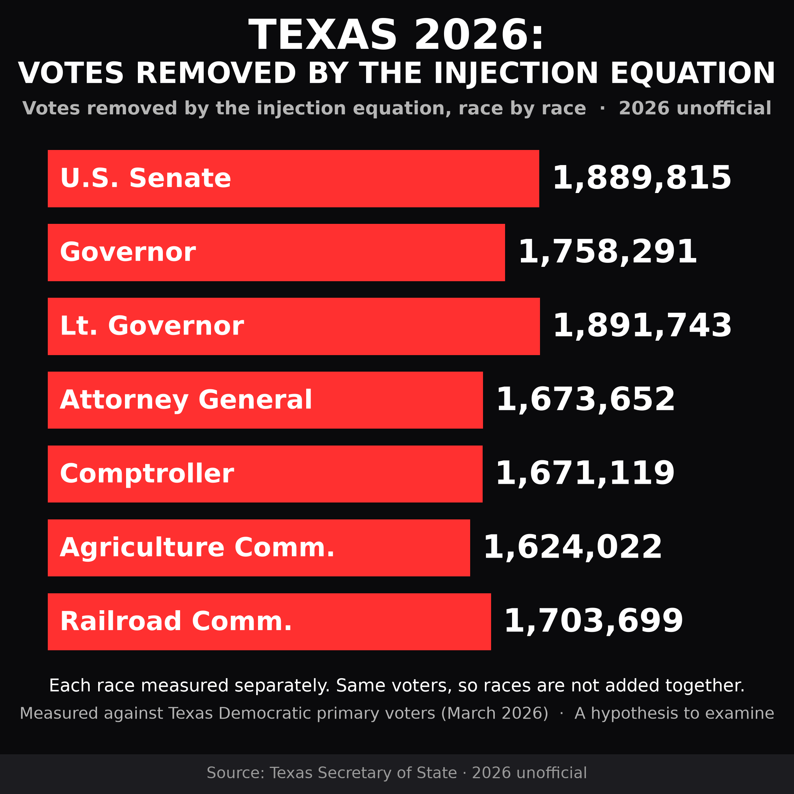
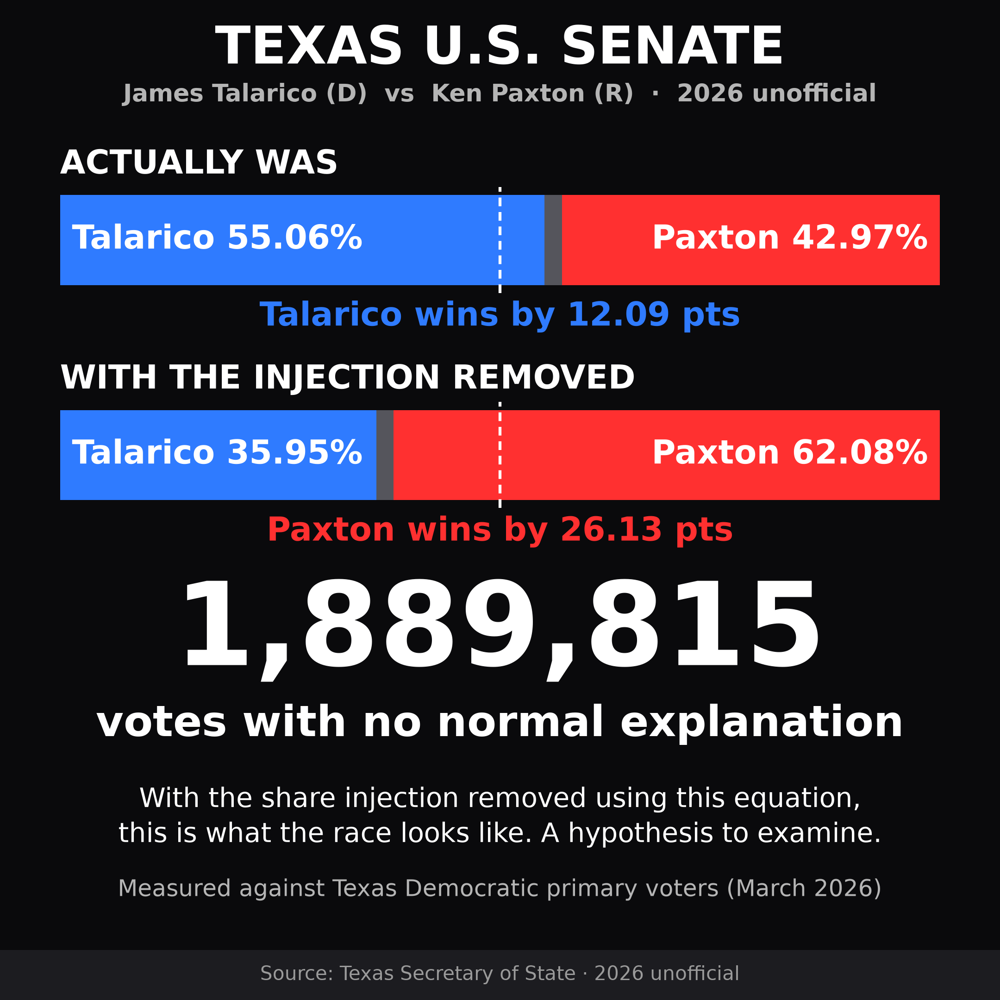
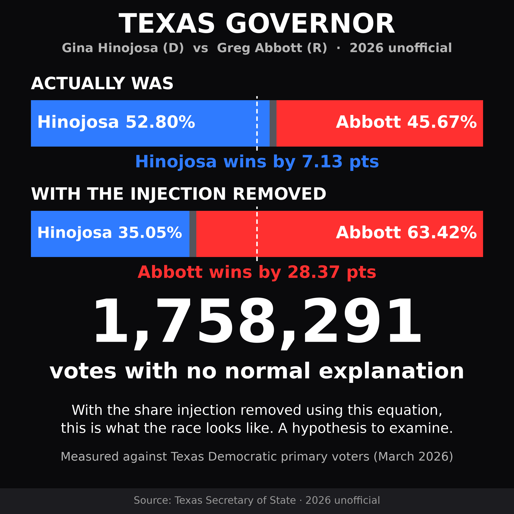
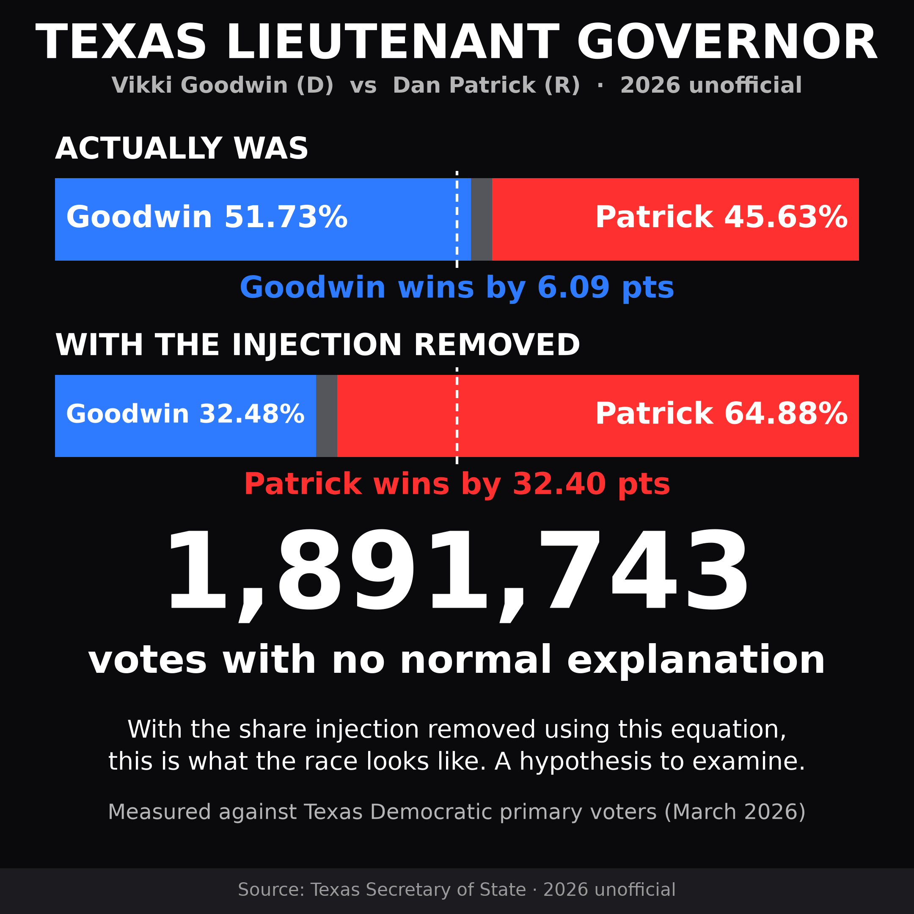
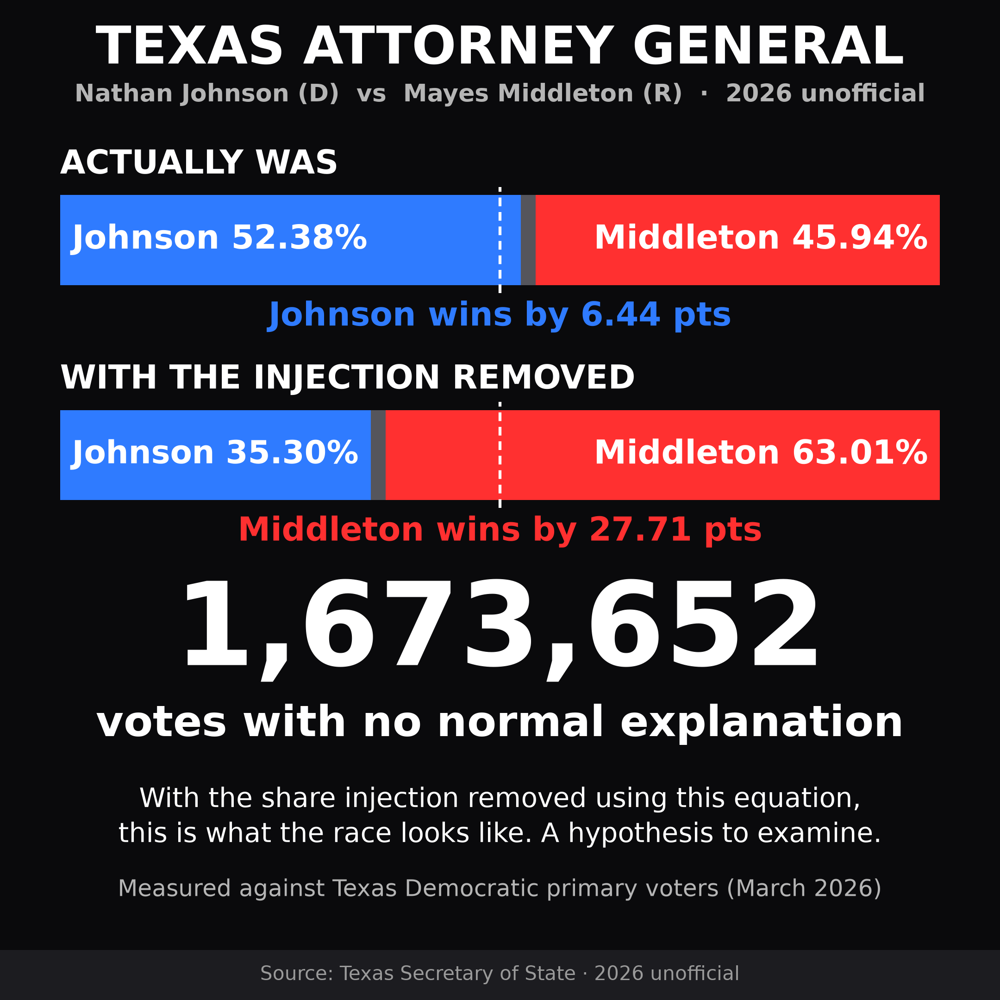
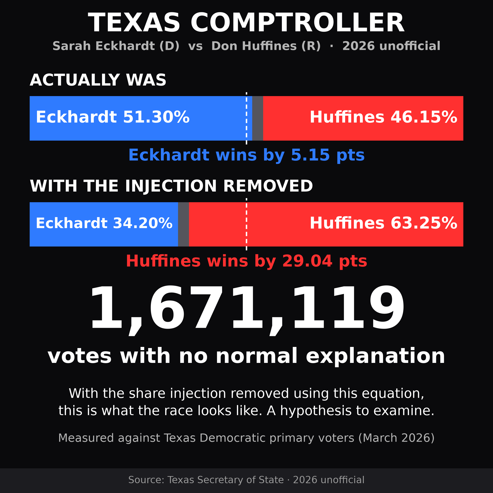
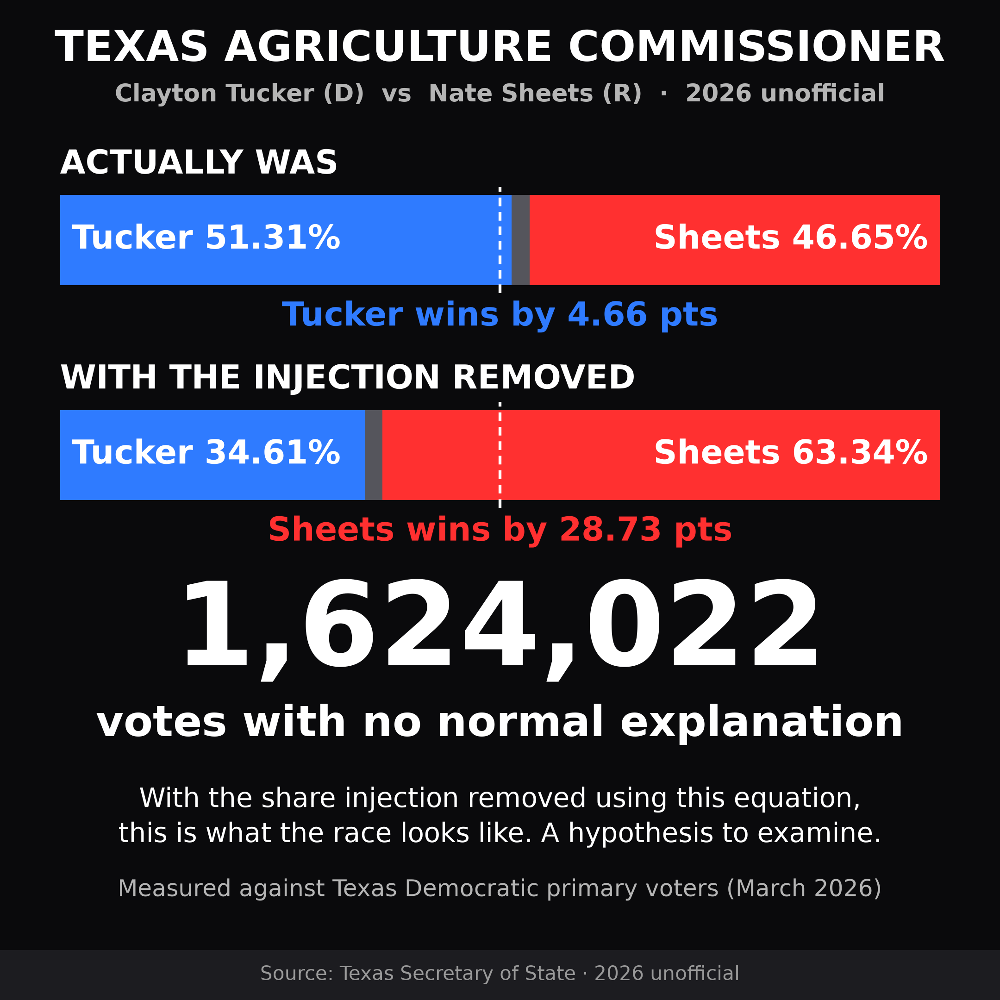
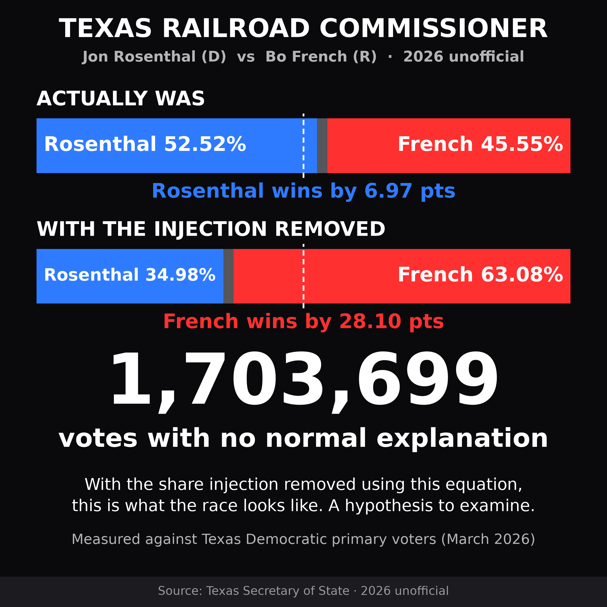

# Full Reversal Analysis: Seven 2026* Statewide Races

> **\*2026 results are unofficial** (Texas SOS election-night file, election 53815, pre-canvass). **Texas has no party registration:** every "Democratic primary voters" figure is the Democratic share of March 2026 Governor-primary voters, Dem ÷ (Dem + Rep). Treating the removals as injected votes is the analyst's hypothesis. The arithmetic measures a pattern; it cannot prove cause.

New to the method? Read **[Methodology: How This Analysis Was Done](Methodology-How-This-Analysis-Was-Done.md)** first. It walks through every step.

## Contents
1. [The locked Texas equation](#the-locked-texas-equation)
2. [Statewide before and after](#statewide-before-and-after)
3. [Who wins with the injection removed](#who-wins-with-the-injection-removed)
4. [Where the offset fits in](#where-the-offset-fits-in)
5. [Top ten counties, every race](#top-ten-counties-every-race)
6. [Counties that flip](#counties-that-flip)
7. [All 254 counties, by race](#all-254-counties-by-race)
8. [Data-quality flags](#data-quality-flags)
9. [Verification](#verification)
10. [Graphics](#graphics)

## The locked Texas equation

For every county: **gap = Democratic votes ÷ ballots cast − Democratic primary-voter share** (both in points). A straight line is fitted through all 254 counties for each race:

**gap = multiplier × (D/100) + offset**, where D is the county's Democratic primary-voter share.

The anchor is the Governor line: **gap = −31.6914(D/100) + 13.4457**. The offset, 13.4457, is the Texas counterpart of Kansas's 6.3014. Each race gets its own line:

| Race (SOS race ID) | Multiplier | Offset | R² |
|---|---|---|---|
| U.S. Senate (5075) | −30.0676 | 14.2008 | 0.587 |
| Governor (3579) | −31.6914 | 13.4457 | 0.629 |
| Lieutenant Governor (4714) | −37.2059 | 12.8342 | 0.670 |
| Attorney General (3) | −31.9242 | 12.0462 | 0.565 |
| Comptroller (21) | −34.2188 | 11.9287 | 0.611 |
| Agriculture Commissioner (19) | −33.7397 | 12.2224 | 0.606 |
| Railroad Commissioner (4843) | −33.1158 | 12.1329 | 0.588 |

## Statewide before and after

Votes are **moved**: the removal comes off the Democrat and goes to the Republican, so the race total does not change.

| Race | Actually was (SOS %) | Votes removed | With the injection removed | Margin before → after | Democratic point drop |
|---|---|---|---|---|---|
| U.S. Senate | James Talarico 55.06% / Ken Paxton 42.97% | **1,889,815** | Talarico 35.95% / Paxton 62.08% | Talarico +12.09 → Paxton +26.13 | 19.11 |
| Governor | Gina Hinojosa 52.80% / Greg Abbott 45.67% | **1,758,291** | Hinojosa 35.05% / Abbott 63.42% | Hinojosa +7.13 → Abbott +28.37 | 17.75 |
| Lieutenant Governor | Vikki Goodwin 51.73% / Dan Patrick 45.63% | **1,891,743** | Goodwin 32.48% / Patrick 64.88% | Goodwin +6.09 → Patrick +32.40 | 19.25 |
| Attorney General | Nathan Johnson 52.38% / Mayes Middleton 45.94% | **1,673,652** | Johnson 35.30% / Middleton 63.01% | Johnson +6.44 → Middleton +27.71 | 17.08 |
| Comptroller | Sarah Eckhardt 51.30% / Don Huffines 46.15% | **1,671,119** | Eckhardt 34.20% / Huffines 63.25% | Eckhardt +5.15 → Huffines +29.04 | 17.10 |
| Agriculture Commissioner | Clayton Tucker 51.31% / Nate Sheets 46.65% | **1,624,022** | Tucker 34.61% / Sheets 63.34% | Tucker +4.66 → Sheets +28.73 | 16.69 |
| Railroad Commissioner | Jon Rosenthal 52.52% / Bo French 45.55% | **1,703,699** | Rosenthal 34.98% / French 63.08% | Rosenthal +6.97 → French +28.10 | 17.53 |

| Race | Dem votes → after | Rep votes → after | All votes in race | Dem share of ballots → after |
|---|---|---|---|---|
| U.S. Senate | 5,444,982 → 3,555,167 | 4,249,373 → 6,139,188 | 9,889,704 | 55.06% → 35.95% |
| Governor | 5,230,789 → 3,472,498 | 4,524,527 → 6,282,818 | 9,907,381 | 52.89% → 35.11% |
| Lieutenant Governor | 5,083,581 → 3,191,838 | 4,484,652 → 6,376,395 | 9,828,050 | 51.40% → 32.27% |
| Attorney General | 5,133,629 → 3,459,977 | 4,502,442 → 6,176,094 | 9,801,621 | 51.91% → 34.99% |
| Comptroller | 5,014,496 → 3,343,377 | 4,511,185 → 6,182,304 | 9,774,685 | 50.70% → 33.81% |
| Agriculture Commissioner | 4,991,896 → 3,367,874 | 4,538,736 → 6,162,758 | 9,729,656 | 50.48% → 34.05% |
| Railroad Commissioner | 5,103,177 → 3,399,478 | 4,426,141 → 6,129,840 | 9,717,302 | 51.60% → 34.37% |

Ballots cast (SOS): 9,889,704 in every race (see [flags](#data-quality-flags)).

## Who wins with the injection removed

- **U.S. Senate:** Ken Paxton (R) wins by 26.13 points. Actually James Talarico (D) won by 12.09.
- **Governor:** Greg Abbott (R) wins by 28.37 points. Actually Gina Hinojosa (D) won by 7.13.
- **Lieutenant Governor:** Dan Patrick (R) wins by 32.40 points. Actually Vikki Goodwin (D) won by 6.09.
- **Attorney General:** Mayes Middleton (R) wins by 27.71 points. Actually Nathan Johnson (D) won by 6.44.
- **Comptroller:** Don Huffines (R) wins by 29.04 points. Actually Sarah Eckhardt (D) won by 5.15.
- **Agriculture Commissioner:** Nate Sheets (R) wins by 28.73 points. Actually Clayton Tucker (D) won by 4.66.
- **Railroad Commissioner:** Bo French (R) wins by 28.10 points. Actually Jon Rosenthal (D) won by 6.97.

All seven races flip from Democrat to Republican. If the votes are only removed rather than moved, the Republican still wins every race:

| Race | Removed only: Dem % / Rep % |
|---|---|
| U.S. Senate | 44.44% / 53.12% |
| Governor | 42.61% / 55.52% |
| Lieutenant Governor | 40.22% / 56.51% |
| Attorney General | 42.57% / 55.39% |
| Comptroller | 41.26% / 55.67% |
| Agriculture Commissioner | 41.55% / 55.99% |
| Railroad Commissioner | 42.42% / 55.23% |

## Where the offset fits in

The full reversal is the county's distance from the line **plus** the offset. The two parts are reported separately so anyone checking this can see each one:

| Race | Votes removed | From the offset | From county gaps (net) | Offset share |
|---|---|---|---|---|
| U.S. Senate | 1,889,815 | 1,403,676 | 486,136 | 74.3% |
| Governor | 1,758,291 | 1,329,047 | 429,246 | 75.6% |
| Lieutenant Governor | 1,891,743 | 1,268,178 | 623,566 | 67.0% |
| Attorney General | 1,673,652 | 1,188,738 | 484,917 | 71.0% |
| Comptroller | 1,671,119 | 1,177,145 | 493,970 | 70.4% |
| Agriculture Commissioner | 1,624,022 | 1,206,132 | 417,888 | 74.3% |
| Railroad Commissioner | 1,703,699 | 1,197,294 | 506,404 | 70.3% |

What to know when you present it:

- **67–76% of each removal comes from the offset.** The offset is taken off every county, so a county sitting exactly on the line still loses 12–14 points.
- **The county-gap part sits in the big metros.** The line is fitted with every county counted equally, so the many small rural counties shape it and the metros sit above it. If the line were instead fitted with each county weighted by its ballots, the county-gap part would net to zero statewide by construction.
- The parts are shown before per-county rounding, so they can differ from the rounded total by a few votes.

This is the hypothesis: the offset and the county gaps together are the share injection. The table lets a reader see exactly how much rests on each part.

## Top ten counties, every race

The same ten counties lead in every race. They hold 64–66% of each statewide removal.

| County | Population | U.S. Senate | Governor | Lieutenant Governor | Attorney General | Comptroller | Agriculture Commissioner | Railroad Commissioner |
|---|---|---|---|---|---|---|---|---|
| Harris | 5,045,026 | 281,185 | 267,248 | 297,342 | 256,855 | 254,779 | 238,124 | 265,738 |
| Dallas | 2,661,397 | 166,523 | 152,197 | 175,802 | 155,141 | 151,998 | 149,767 | 159,645 |
| Tarrant | 2,248,466 | 146,676 | 136,258 | 151,225 | 132,857 | 133,569 | 131,724 | 138,564 |
| Bexar | 2,160,088 | 137,471 | 131,634 | 140,713 | 121,913 | 123,211 | 121,142 | 123,309 |
| Travis | 1,389,670 | 127,667 | 119,008 | 135,952 | 113,088 | 116,566 | 105,583 | 115,304 |
| Collin | 1,297,179 | 101,535 | 88,669 | 96,799 | 88,019 | 86,758 | 81,586 | 87,734 |
| Denton | 1,069,346 | 78,858 | 70,291 | 76,900 | 67,900 | 67,200 | 64,713 | 67,867 |
| Fort Bend | 975,191 | 73,700 | 67,118 | 74,000 | 64,614 | 63,798 | 63,107 | 66,946 |
| Williamson | 752,827 | 58,455 | 52,926 | 58,371 | 51,020 | 51,831 | 48,127 | 51,055 |
| El Paso | 877,858 | 48,467 | 45,407 | 47,673 | 43,343 | 42,768 | 43,984 | 43,301 |
| **Top-ten total** | | **1,220,537** | **1,130,756** | **1,254,777** | **1,094,750** | **1,092,478** | **1,047,857** | **1,119,463** |
| Share of statewide removal | | 64.6% | 64.3% | 66.3% | 65.4% | 65.4% | 64.5% | 65.7% |

Each race page under [All 254 counties](#all-254-counties-by-race) has the full row for each of these counties: ballots, Democratic and Republican votes before and after, and the removal in points.

## Counties that flip

**U.S. Senate**: 21 counties flip D → R (40 won by the Democrat → 19): Harris, Tarrant, Bexar, Collin, Denton, Fort Bend, Williamson, Cameron, Brazoria, Bell, Nueces, Hays, Jefferson, Brazos, Kaufman, Bastrop, Caldwell, Val Verde, Jim Wells, Kleberg, Brewster.  
Stay Democratic: Dallas, Travis, Hidalgo, El Paso, Webb, Starr, Maverick, Willacy, Frio, Zapata, Reeves, Duval, Zavala, Dimmit, Brooks, La Salle, Presidio, Jim Hogg, Culberson.

**Governor**: 21 counties flip D → R (37 won by the Democrat → 16): Harris, Tarrant, Bexar, Collin, Denton, Fort Bend, Williamson, Cameron, Brazoria, Nueces, Hays, Jefferson, Brazos, Bastrop, Caldwell, Val Verde, Jim Wells, Kleberg, Frio, Brewster, Culberson.  
Stay Democratic: Dallas, Travis, Hidalgo, El Paso, Webb, Starr, Maverick, Willacy, Zapata, Duval, Zavala, Dimmit, Brooks, La Salle, Presidio, Jim Hogg.

**Lieutenant Governor**: 21 counties flip D → R (36 won by the Democrat → 15): Harris, Dallas, Tarrant, Bexar, Collin, Denton, Fort Bend, El Paso, Williamson, Cameron, Brazoria, Nueces, Hays, Jefferson, Bastrop, Caldwell, Val Verde, Jim Wells, Kleberg, Frio, Brewster.  
Stay Democratic: Travis, Hidalgo, Webb, Starr, Maverick, Willacy, Zapata, Duval, Zavala, Dimmit, Brooks, La Salle, Presidio, Jim Hogg, Culberson.

**Attorney General**: 19 counties flip D → R (36 won by the Democrat → 17): Harris, Tarrant, Bexar, Collin, Denton, Fort Bend, Williamson, Cameron, Brazoria, Nueces, Hays, Jefferson, Bastrop, Caldwell, Val Verde, Jim Wells, Kleberg, Brewster, Duval.  
Stay Democratic: Dallas, Travis, Hidalgo, El Paso, Webb, Starr, Maverick, Willacy, Frio, Zapata, Zavala, Dimmit, Brooks, La Salle, Presidio, Jim Hogg, Culberson.

**Comptroller**: 18 counties flip D → R (34 won by the Democrat → 16): Harris, Dallas, Tarrant, Bexar, Collin, Fort Bend, Williamson, Cameron, Nueces, Hays, Jefferson, Bastrop, Caldwell, Val Verde, Jim Wells, Kleberg, Brewster, Duval.  
Stay Democratic: Travis, Hidalgo, El Paso, Webb, Starr, Maverick, Willacy, Frio, Zapata, Zavala, Dimmit, Brooks, La Salle, Presidio, Jim Hogg, Culberson.

**Agriculture Commissioner**: 18 counties flip D → R (35 won by the Democrat → 17): Harris, Dallas, Tarrant, Bexar, Collin, Fort Bend, Williamson, Cameron, Nueces, Hays, Jefferson, Bastrop, Caldwell, Val Verde, Jim Wells, Kleberg, Brewster, Duval.  
Stay Democratic: Travis, Hidalgo, El Paso, Webb, Starr, Maverick, Willacy, Frio, Zapata, Reeves, Zavala, Dimmit, Brooks, La Salle, Presidio, Jim Hogg, Culberson.

**Railroad Commissioner**: 19 counties flip D → R (36 won by the Democrat → 17): Harris, Tarrant, Bexar, Collin, Denton, Fort Bend, Williamson, Cameron, Brazoria, Nueces, Hays, Jefferson, Bastrop, Caldwell, Val Verde, Jim Wells, Kleberg, Brewster, Duval.  
Stay Democratic: Dallas, Travis, Hidalgo, El Paso, Webb, Starr, Maverick, Willacy, Frio, Zapata, Zavala, Dimmit, Brooks, La Salle, Presidio, Jim Hogg, Culberson.

## All 254 counties, by race

Each page lists every county, largest to smallest: Democratic primary-voter share, actual Democratic share of ballots, distance from the line, offset, removal in points and votes, and the county's numbers with the injection removed.

- [U.S. Senate: all 254 counties](Full-Reversal-Senate-Counties.md) · [CSV](../master/TX_senate_full_reversal_master_254_counties.csv) · [XLSX](../master/TX_senate_full_reversal_master.xlsx)
- [Governor: all 254 counties](Full-Reversal-Governor-Counties.md) · [CSV](../master/TX_governor_full_reversal_master_254_counties.csv) · [XLSX](../master/TX_governor_full_reversal_master.xlsx)
- [Lieutenant Governor: all 254 counties](Full-Reversal-Lt-Governor-Counties.md) · [CSV](../master/TX_lt_governor_full_reversal_master_254_counties.csv) · [XLSX](../master/TX_lt_governor_full_reversal_master.xlsx)
- [Attorney General: all 254 counties](Full-Reversal-Attorney-General-Counties.md) · [CSV](../master/TX_attorney_general_full_reversal_master_254_counties.csv) · [XLSX](../master/TX_attorney_general_full_reversal_master.xlsx)
- [Comptroller: all 254 counties](Full-Reversal-Comptroller-Counties.md) · [CSV](../master/TX_comptroller_full_reversal_master_254_counties.csv) · [XLSX](../master/TX_comptroller_full_reversal_master.xlsx)
- [Agriculture Commissioner: all 254 counties](Full-Reversal-Agriculture-Commissioner-Counties.md) · [CSV](../master/TX_agriculture_full_reversal_master_254_counties.csv) · [XLSX](../master/TX_agriculture_full_reversal_master.xlsx)
- [Railroad Commissioner: all 254 counties](Full-Reversal-Railroad-Commissioner-Counties.md) · [CSV](../master/TX_railroad_full_reversal_master_254_counties.csv) · [XLSX](../master/TX_railroad_full_reversal_master.xlsx)
## Data-quality flags

- **Ballots cast equals the U.S. Senate total.** In the SOS election-night file the ballots figure matches the Senate race total in every county, so down-ballot races can exceed it. The Governor race is higher than ballots in 241 counties.
- **Over-ballot (Democrat + Republican > ballots):** Governor in 11 counties (Starr, Maverick, Zapata, Duval, Zavala, La Salle, Jim Hogg, Culberson, Terrell, Kent, McMullen); Attorney General, Agriculture and Railroad in Duval; Comptroller in Duval and Throckmorton. Senate and Lieutenant Governor: none.
- **Duval:** a down-ballot reporting error. In the AG race it shows 3,532 Democratic + 1,522 Republican votes on 3,280 ballots. Its flip in AG, Comptroller, Agriculture and Railroad rests on that data.
- **Starr and Zapata:** election-night ballot counts are known to run low (Starr's canvass shows 14,930 ballots against 13,082 in the file).
- **Zeroed counties** (came out negative, set to zero): U.S. Senate: Reeves, La Salle, Kenedy, Loving; Governor: Reeves, La Salle, Kenedy, Loving; Lieutenant Governor: Zapata, Reeves, La Salle, Kenedy, Loving; Attorney General: Starr, Zapata, Reeves, La Salle, Kenedy, Loving; Comptroller: Starr, Zapata, Reeves, La Salle, Kenedy, Loving; Agriculture Commissioner: Starr, Zapata, Reeves, La Salle, Kenedy, Loving; Railroad Commissioner: Starr, Zapata, Reeves, La Salle, Kenedy, Loving.
- **Railroad Commissioner:** the SOS file has a single race, ID 4843 (Rosenthal vs French), with no "Term Exp 2032" label.

## Verification

Two independent passes re-read the raw Texas Secretary of State files for all 254 counties in every race. Pass A used pandas; Pass B used the Python standard library with exact fractions and found each race by name. Every cell had to match before anything shipped. Each race was also checked against the SOS statewide totals and published percentages.

| Race | County cells | Summary checks | SOS statewide checks | Total | Mismatches |
|---|---|---|---|---|---|
| U.S. Senate | 8,890 | 40 | 5 | 8,935 | 0 |
| Governor | 8,890 | 40 | 5 | 8,935 | 0 |
| Lieutenant Governor | 8,890 | 40 | 5 | 8,935 | 0 |
| Attorney General | 8,890 | 40 | 5 | 8,935 | 0 |
| Comptroller | 8,890 | 40 | 5 | 8,935 | 0 |
| Agriculture Commissioner | 8,890 | 40 | 5 | 8,935 | 0 |
| Railroad Commissioner | 8,890 | 40 | 5 | 8,935 | 0 |
| **All seven** | | | | **62,545** | **0** |

## Graphics

*Each race is measured separately. They are the same voters, so the races are not added together.*

*2026 figures are unofficial. Source: Texas Secretary of State.*